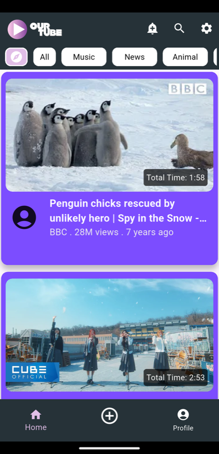
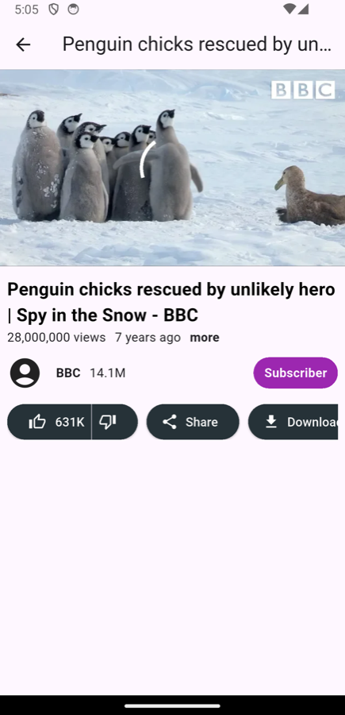
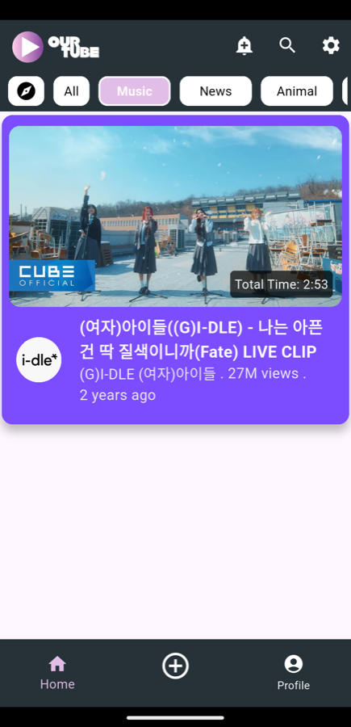
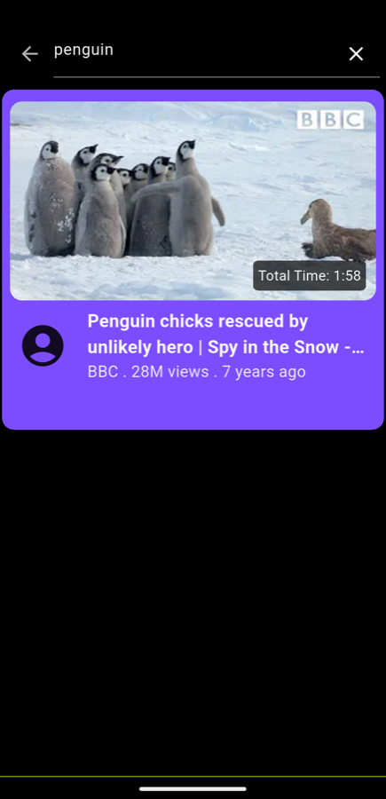
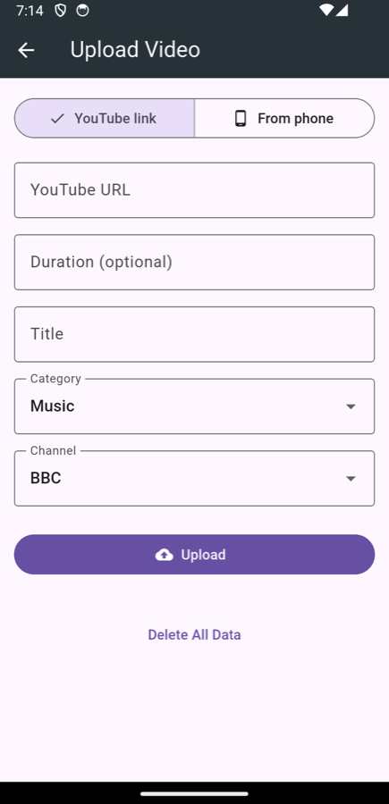

# OurTube

แอปดูวิดีโอ YouTube สร้างด้วย Flutter (โปรเจกต์รายวิชา CP213)

## ภาพการใช้งาน

| หน้าแรก | เล่นวิดีโอ | กรองตามหมวดหมู่ |
| :---: | :---: | :---: |
|  |  |  |
| รายการวิดีโอ พร้อมชื่อช่อง ยอดวิว และเวลาที่อัปโหลด | กดที่วิดีโอเพื่อเปิดหน้าเล่น ดูรายละเอียดและปุ่ม Like / Share / Download | กดแท็บ All, Music, News, Animal ฯลฯ เพื่อกรองวิดีโอ |

| ค้นหา | อัปโหลดวิดีโอ |
| :---: | :---: |
|  |  |
| กดไอคอนแว่นขยาย พิมพ์คำค้นแล้วกด Enter (ค้นจากชื่อวิดีโอใน database) | กดปุ่ม ⊕ ตรงกลางแถบล่าง เลือก **YouTube link** (วางลิงก์) หรือ **From phone** (เลือกไฟล์จากเครื่อง) กรอกชื่อ หมวดหมู่ ช่อง แล้วกด **Upload** |

## ฟีเจอร์

- แสดงรายการวิดีโอพร้อมภาพปก ความยาว ยอดวิว (เช่น 28M) และเวลาที่ผ่านมา (เช่น 7 years ago)
- อัปโหลดวิดีโอได้ 2 แบบ: วางลิงก์ YouTube (ดึงภาพปกให้อัตโนมัติ) หรือเลือกไฟล์วิดีโอจากเครื่อง (อ่านความยาวให้อัตโนมัติ)
- เล่นวิดีโอ YouTube ด้วย `youtube_player_flutter` และวิดีโอจากเครื่องด้วย `video_player`
- กรองวิดีโอตามหมวดหมู่ (จัดการ state ด้วย `provider`)
- ค้นหาวิดีโอจากชื่อ
- เก็บข้อมูลวิดีโอในเครื่องด้วย `sqflite` ทุกหน้า (หน้าแรก หมวดหมู่ ค้นหา) ดึงข้อมูลจาก database

## สิ่งที่ต้องมี

- Flutter 3.47 ขึ้นไป (Dart 3.13+)
- Android SDK + JDK 17 ขึ้นไป (ใช้ JDK ที่มากับ Android Studio ได้)
- Android Gradle Plugin 8.11 / Gradle 8.14 (ตั้งค่าไว้ในโปรเจกต์แล้ว)

## วิธีรัน

```bash
git clone https://github.com/Puriice/ourtube.git
cd ourtube
flutter pub get
flutter run
```

เปิดแอปครั้งแรก database ยังว่าง หน้าแรกจะขึ้นว่า *No videos yet* ให้กดปุ่ม ⊕ แล้วอัปโหลดวิดีโอก่อน

วิดีโอที่อัปโหลดจากเครื่องจะถูกคัดลอกไปเก็บในโฟลเดอร์ของแอป (`videos/`) กด **Delete All Data** จะลบทั้งข้อมูลใน database และไฟล์ที่คัดลอกไว้

> **หมายเหตุ:** ถ้าเปิดโปรเจกต์ใน VS Code แล้วมีส่วนขยาย Java/Gradle ติดตั้งอยู่ ส่วนขยายอาจแก้ไฟล์
> `android/gradle/wrapper/gradle-wrapper.properties` เป็น Gradle 9.x ซึ่งใช้กับ AGP 8 ไม่ได้
> ถ้า build ไม่ผ่าน ให้ตรวจว่า `distributionUrl` ยังเป็น `gradle-8.14.3-all.zip`

## โครงสร้างโปรเจกต์

```
lib/
├── main.dart                 # จุดเริ่มต้นของแอป
├── screens/                  # หน้าจอ: home, video_play, search, add_video
├── components/               # วิดเจ็ตย่อย: card, top_bar, nav_bar, ตัวจัดรูปแบบตัวเลข/เวลา
├── model/                    # โมเดล Video, User
├── providers/                # state หมวดหมู่ที่เลือก และรายการวิดีโอจาก database
└── database/                 # การเชื่อมต่อ SQLite และ service สำหรับดึง/ค้นหาวิดีโอ
```
