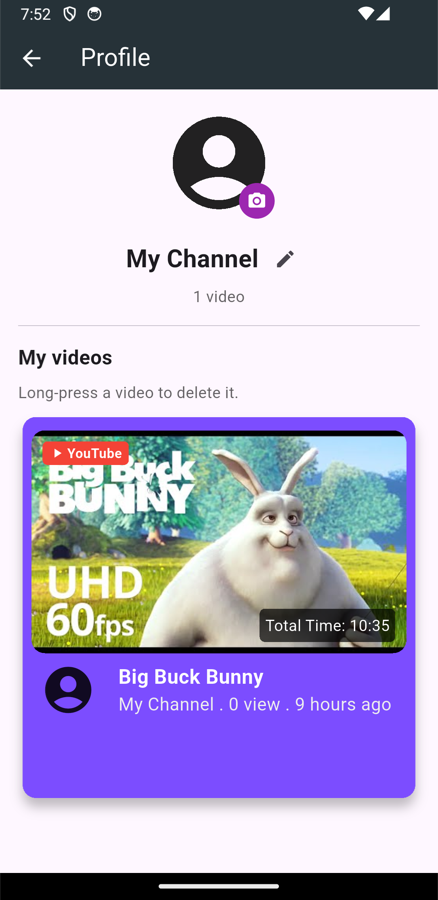
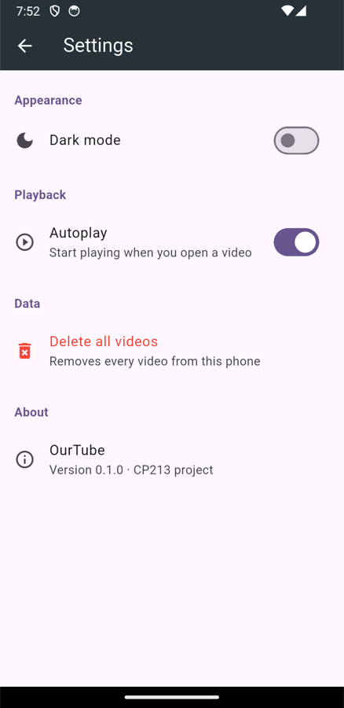
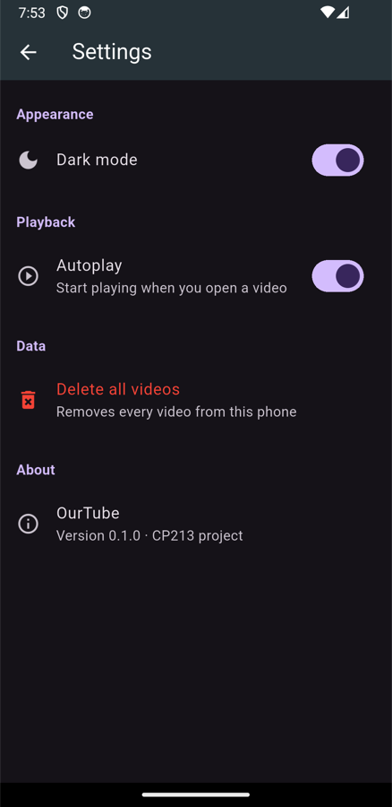

# OurTube

A Flutter app for watching and uploading videos, built as a CP213 course project.
All data is stored on the phone with SQLite, so no server is needed.

## Why we built it

We built OurTube for people who want to avoid ads on YouTube. Instead of browsing YouTube
itself, you keep your own list of videos: save the YouTube links you want to watch and
upload videos from your phone, all in one place.

> **Note:** YouTube videos play through YouTube's official embedded player, so YouTube
> may still show ads on some of them. Videos uploaded from your phone never have ads.

## Screenshots

| Home | Video player | Category filter |
| :---: | :---: | :---: |
|  |  |  |
| Videos sorted from newest to oldest, with channel name, views and upload time | Tap a video to open it and see its details and the Like / Share / Download buttons | Tap All, Music, News, Animal, etc. to filter videos |

| Search | Upload | Profile |
| :---: | :---: | :---: |
|  |  |  |
| Tap the search icon, type a keyword and press Enter | Tap ⊕ in the bottom bar, then paste a YouTube link or pick a file from your phone | Tap the Profile tab to see your uploads and change your name and picture |

| Settings | Dark mode |
| :---: | :---: |
|  |  |
| Tap the gear icon in the top-right corner | Turn on dark mode from the settings screen |

## Features

**Watching videos**
- Video list with thumbnail, duration, view count (for example 28M) and time since upload (for example 7 years ago)
- YouTube videos play with `youtube_player_flutter`; videos from your phone play with `video_player`
- Videos added from a YouTube link have a red **▶ YouTube** tag on the card and the player screen
- Filter videos by category and search by title

**Uploading videos**
- **YouTube link:** paste a link (or the 11-character video ID) and the thumbnail is fetched automatically
- **From phone:** pick a video from your gallery; the app reads its duration and copies the file into the app's folder
- Uploaded videos belong to your profile, so there's no channel to choose

**Profile**
- Change your name (tap the pencil) and profile picture (tap the picture)
- See the videos you uploaded; long-press a video to delete it

**Settings**
- **Dark mode:** switch between light and dark themes
- **Autoplay:** start playing as soon as a video opens
- **Delete all videos:** removes every video, including the copied files
- Settings are saved with `shared_preferences`, so they stay after you close the app

## Requirements

- Flutter 3.47 or later (Dart 3.13+)
- Android SDK and JDK 17 or later (the JDK bundled with Android Studio works)
- Android Gradle Plugin 8.11 / Gradle 8.14 (already set up in the project)

## Getting started

```bash
git clone https://github.com/Puriice/ourtube.git
cd ourtube
flutter pub get
flutter run
```

The database is empty the first time you open the app, so the home screen shows *No videos yet*.
Tap ⊕ to upload your first video.

> **Note:** If you open the project in VS Code with a Java/Gradle extension installed, the extension
> may change `android/gradle/wrapper/gradle-wrapper.properties` to Gradle 9.x, which doesn't work
> with AGP 8. If the build fails, check that `distributionUrl` still points to `gradle-8.14.3-all.zip`.

## Project structure

```
lib/
├── main.dart                 # App entry point, themes and providers
├── screens/                  # Screens: home, video_play, search, add_video, profile, settings
├── components/               # Widgets: card, top_bar, nav_bar, user_avatar, youtube_tag, number/time formatters
├── model/                    # Video and User models
├── providers/                # State: selected category, videos and profile, settings
└── database/                 # SQLite connection and services for videos and the profile
```

**Database (SQLite)** has two tables:
- `Video` stores the videos. The `source` column is `youtube` or `local`, and `localPath` holds the file path of videos uploaded from the phone.
- `Profile` stores your name and profile picture.
